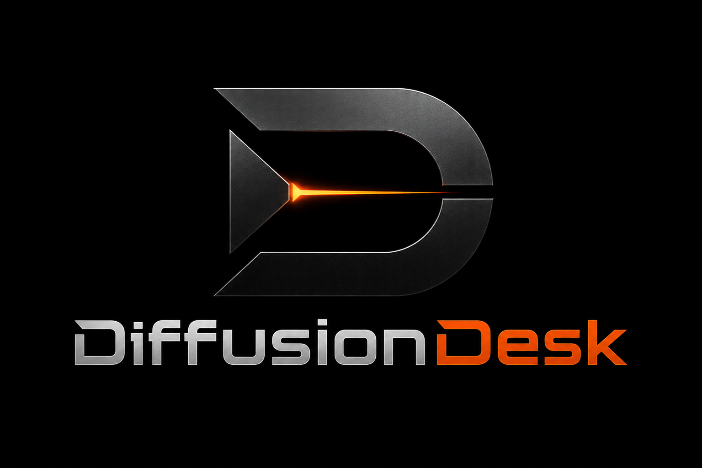
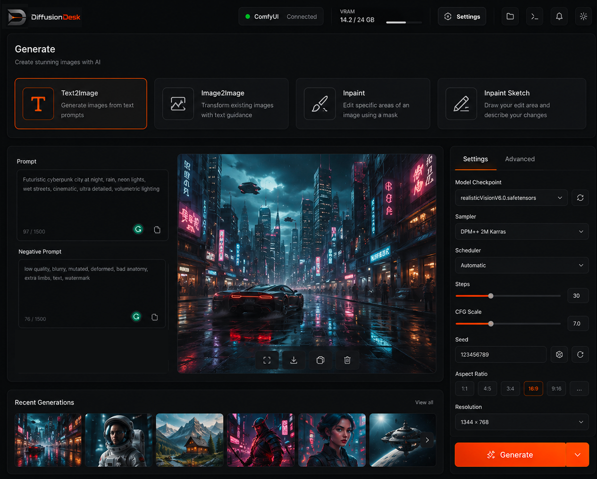
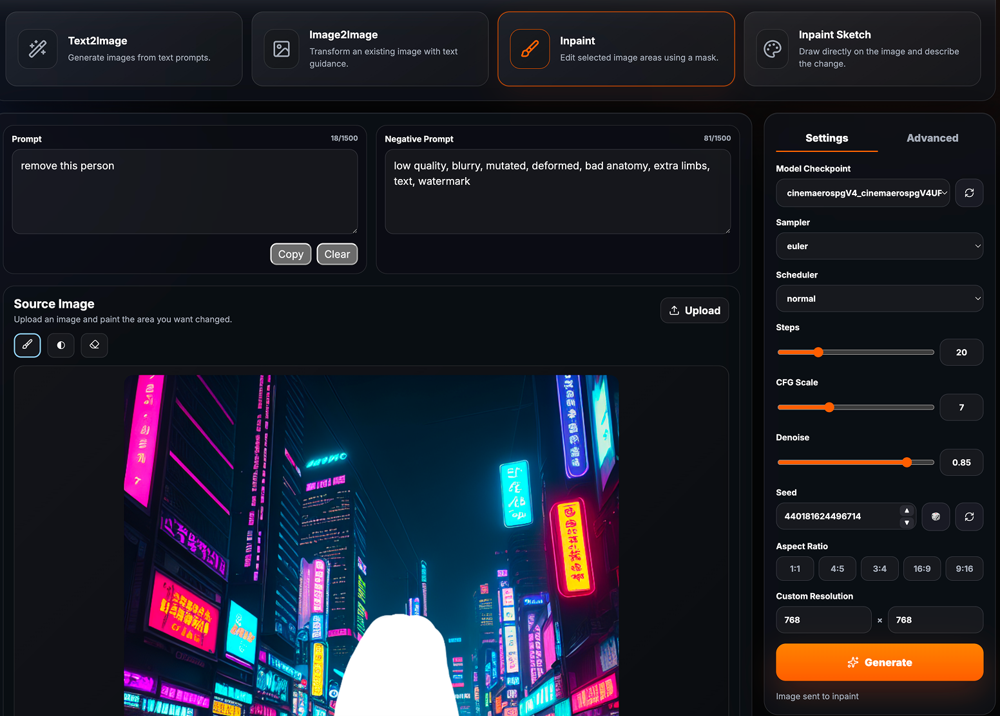
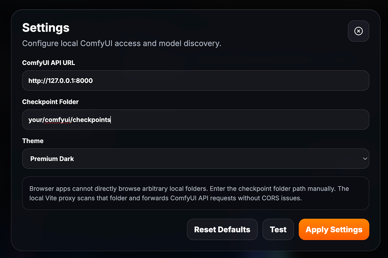

# DiffusionDesk

<p align="center">
  
</p>

<p align="center">
  <strong>Modern local-first AI image workstation for ComfyUI.</strong>
</p>

<p align="center">
  Text2Image • Image2Image • Inpaint • Inpaint Sketch
</p>

<p align="center">
  Premium glass UI inspired by modern creative software.
</p>

---

## Preview

<p align="center">
  
</p>

<p align="center">
  
  
</p>

---

## Features

- Modern glassmorphism UI
- Local-first architecture
- Direct ComfyUI integration
- Text2Image
- Image2Image
- Inpaint
- Inpaint Sketch
- Generation history
- Checkpoint selector
- Dark / Light mode
- Local proxy with CORS handling
- Configurable API endpoint
- Responsive design

---

## Installation

```bash
git clone https://github.com/tonybriant/diffusiondesk.git
cd diffusiondesk
npm install
npm run dev
